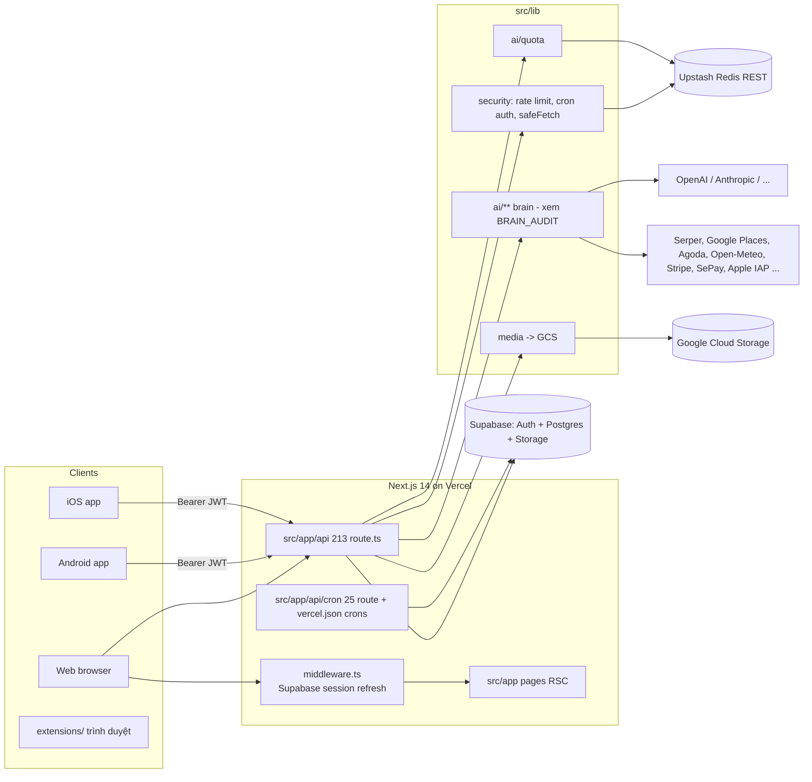

# TAPPY_CURRENT_ARCHITECTURE — bản đồ kiến trúc thực tế (READ-ONLY AUDIT)

- Nguồn: `D:/TappyAI-wt/wt-integration`, nhánh `feat/brain-r13-p1`, HEAD `b0fe4bf13ac77629a6662a6bae068c393ed767de`. Ngày audit: 2026-11-18.
- Phạm vi tài liệu này: (1) lõi + vòng đời request web, (13) Web / Android / iOS và hợp đồng API, (14) DB, Redis, Storage, cron, hạ tầng, feature flag, tên biến môi trường, và mục bản source trùng lặp / worktree.
- Bộ não AI (agent, prompt, memory, tool, search, verification) và chi phí/quota: xem `TAPPY_AI_BRAIN_AUDIT.md` / `TAPPY_COST_TOKEN_AUDIT.md` (do tác tử khác viết). Ở đây chỉ có sơ đồ khối.
- Phương pháp: chỉ đọc mã và cấu hình bằng Grep/Read/`git`. Không chạy build/test/migration, không truy cập DB/production/mạng, không đọc `.env*`.

## 0. Quy ước nhãn

Trạng thái: IMPLEMENTED (có mã) / TESTED (có tệp test trong repo — KHÔNG có nghĩa là đã chạy xanh trong audit này, audit không chạy test) / VERIFIED (có log hoặc đo đạc) / PRODUCTION VERIFIED (có bằng chứng chạy production).
Bằng chứng: CODE / LOG / BENCHMARK / SUY LUẬN / CHƯA XÁC MINH.

Trong toàn tài liệu KHÔNG có mục nào được gắn PRODUCTION VERIFIED, vì audit này không truy cập production và repo không chứa bằng chứng chạy production trực tiếp. Mọi câu về "đang chạy trên production" đều là CHƯA XÁC MINH.

## 1. Tổng quan kiến trúc

| Lớp | Công nghệ (CODE) | Vị trí |
|---|---|---|
| Web + API | Next.js 14.2.35 (App Router), React 18.3, TypeScript | `package.json` (deps), `src/app/**` |
| Số route | 213 tệp `route.ts` dưới `src/app/api`, 90 tệp `page.tsx` dưới `src/app` | đếm bằng `find` |
| Middleware | 1 tệp, chỉ làm mới phiên Supabase + chặn `/admin` khi chưa đăng nhập | `middleware.ts:5-62`, `config.matcher` ở `middleware.ts:64-66` |
| Auth | Supabase Auth (cookie qua `@supabase/ssr`; Bearer JWT cho native) | `src/lib/auth/getRequestUser.ts:18-38` |
| DB | Supabase Postgres (RLS + RPC + migration SQL) | `supabase/migrations/**` |
| Cache / giới hạn tần suất | Upstash Redis qua REST (`KV_REST_API_*` hoặc `UPSTASH_REDIS_REST_*`) | `src/lib/security/distributedRateLimit.ts:180-216` |
| Media | Google Cloud Storage (writer duy nhất); chat media ở Supabase Storage bucket riêng | `src/lib/media/index.ts:51-59`, `src/lib/messaging/media.ts:7` |
| LLM | Vercel AI SDK (`ai ^4.3`, `@ai-sdk/openai 1.3.24`, `@ai-sdk/anthropic ^1.0`) qua adapter chọn bởi `LLM_PROVIDER` (mặc định `openai`) | `src/lib/ai/llm/registry.ts:53-80` |
| Triển khai | Vercel (cron trong `vercel.json`, `ignoreCommand`) | `vercel.json`, `scripts/vercel-ignore.mjs` |
| Mobile | Android (Kotlin/Retrofit, nhiều module Gradle), iOS (Swift, XcodeGen `ios/project.yml`) | `android/**`, `ios/**` |

Sơ đồ khối mức cao:



## 2. Vòng đời request web (mục 1)

### 2.1 Tầng middleware

- `middleware.ts:5-62`: tạo `createServerClient` với `NEXT_PUBLIC_SUPABASE_URL` + `NEXT_PUBLIC_SUPABASE_ANON_KEY`, gọi `supabase.auth.getUser()` (dòng 41) để làm mới cookie. Chỉ một quyết định chặn: `/admin*` mà `!user` thì redirect `/login?<RETURN_TO_PARAM>=...` (dòng 52-61). `/api/admin/*` không bị middleware chặn (handler tự trả 401/403 — theo chú thích dòng 43-46; kiểm từng handler: CHƯA KIỂM TRA đầy đủ).
- `config.matcher` (dòng 65): loại `_next/static`, `_next/image`, `favicon.ico`, `api/csp-report` và đuôi ảnh. Nghĩa là MỌI `/api/*` khác (kể cả `/api/chat`, `/api/cron/*`) đi qua một lần `auth.getUser()` tới Supabase Auth. Trạng thái: IMPLEMENTED (CODE). Test trực tiếp middleware: CHƯA XÁC MINH (không có `middleware.test.ts` ở gốc).
- Header bảo mật/CSP: `next.config.mjs` `async headers()` (CSP gồm `default-src 'self'`, `frame-ancestors 'self'`, script-src có `'unsafe-inline'`, dev thêm `'unsafe-eval'`); `poweredByHeader: false`. Có test `src/lib/security/poweredByHeader.test.ts`, `cspReport.test.ts`. IMPLEMENTED/TESTED (CODE).
- Guard khởi động: `next.config.mjs` gọi `assertNotProduction({ command })` từ `scripts/prodEnvGuard.mjs` cho `dev|build|start` (từ chối khi env trỏ vào Supabase production, trừ build thật của Vercel). IMPLEMENTED (CODE).

### 2.2 Danh định người dùng

`getRequestUser(req)` (`src/lib/auth/getRequestUser.ts:18-38`): nếu có header `Authorization: Bearer <jwt>` → tạo client Supabase gắn Bearer rồi `auth.getUser(bearerToken)` (dòng 33); ngược lại dùng cookie qua `createServerClient` (`src/lib/supabase/server.ts:4`) và `auth.getUser()` (dòng 38). Trả `{ user, supabase }`. Dùng chung cho web và native. Khách ẩn danh = phiên Supabase anonymous (`POST /api/auth/anonymous` → `signInAnonymously`, `src/app/api/auth/anonymous/route.ts:53`, kèm limiter `anon-session:${ip}` 5/phút tại dòng 32). Service-role: `createAdminClient()` (`src/lib/supabase/admin.ts:9`), có test `adminServerOnly.test.ts`.

### 2.3 `POST /api/chat` — thứ tự thực tế các cổng

Tệp `src/app/api/chat/route.ts` (4682 dòng; `maxDuration = 300` ở dòng 222; `POST` ở dòng 229). Thứ tự các bước chạy TRƯỚC khi gọi model (CODE):

| # | Bước | Dòng | Ghi chú |
|---|---|---|---|
| 1 | `flushPending(req)` đẩy log chi phí của request trước | ~250 | không await, không throw |
| 2 | Flood guard theo IP: `publicRateLimit('chat:ip:<ip>', CHAT_IP_BURST_PER_MINUTE, 60_000)` → 429 `rate_limit` | 257-266 | giá trị 30/phút theo test `chatCaps.route.test.ts:90` |
| 3 | Đọc body có trần: `readCappedBody` → 413/400 | 283-292 | `src/lib/http/readCappedBody.ts` |
| 4 | `JSON.parse`, nén lịch sử `compactRequestMessages` | ~294-312 | |
| 5 | `validateClientInput` (allowlist, dựng lại message; client không được tự đặt `system`/tool result) | ~314 | `src/lib/ai/security/clientInput.ts` |
| 6 | PDF đính kèm → văn bản `pdfPartsToText` | ~330 | |
| 7 | Lấy user: `getRequestUser(req)` (dòng 542) | 542 | |
| 8 | Đồng ý dữ liệu AI: `refuseWithoutAiConsent(user.id, locale)` → 403 `ai_consent_required` | 559-562 | `src/lib/ai/consent/aiConsentGuard.ts:12-22`; chỉ áp cho user đã đăng nhập (xem Quan sát Q3) |
| 9 | Cổng 18+: guest khai báo / `getAgeEligibility(supabase)` | 1054-1125 | trước quota và trước model |
| 10a | Ẩn danh: `consumeAiQuestion(aiQuotaIdentity(user, ip))` → 401 `anon_limit_reached` (5 câu trọn đời) | 1139-1151 | `ANON_LIFETIME_LIMIT=5` (`src/lib/config/product.ts:33`) |
| 10b | Đăng nhập: `getAccountRestriction` (tạm khóa) → burst theo user `chat:user:<id>` (dòng 1255) → `consumeAiQuestion` (dòng 1272) → trần Pro `publicDailyRateLimit('chat:pro:<id>', PRO_DAILY_CHAT_CAP)` (dòng 1293) | 1150-1300 | |
| 11 | Deep research: `withinGlobalDeepCeiling()` (3724), `consumeDeepResearch` (3743/3750) | 3722-3770 | chỉ khi bật chế độ nghiên cứu sâu |
| 12 | Dựng prompt/tool, gọi model: `result = agentOn ? await agentTurn(...) : AI.stream(streamOpts)` | 4279 | brain — xem BRAIN_AUDIT |
| 13 | Stream: `result.toDataStreamResponse()` (AI SDK data-stream) rồi bọc các lớp hậu xử lý (`planCompletionStream`, `finalWriteStream`, `prefixBody`, guard stream) | 4303-4672 | |
| 14 | Biến thể trả sớm có độ trễ: `Response(deferredBody(...), { 'Content-Type': 'text/event-stream', 'X-Decision-Evidence-Id' })` | 4675-4677 | |

Lỗi khởi tạo stream trả response lỗi tại dòng 4285-4288. Hoàn quota khi lượt AI lỗi: `refundAiQuestion` (`src/lib/ai/quota/aiQuestionQuota.ts:216`), nhắc ở dòng 3706 của route.

Khối bộ não (chỉ sơ đồ, chi tiết ở tài liệu khác):

```mermaid
flowchart TD
  C[client message] --> G[gates: IP burst, body cap, validateClientInput, consent, 18+, quota]
  G --> P[prompt + tool selection<br/>ONE_BRAIN / Agent runtime v2 (TAPPY_AGENT=2) / legacy consultative]
  P --> M[AI.stream -> LLM provider registry]
  M <--> T[tools: Serper, Places, hotels, weather, ...]
  M --> S[post-stream guards + enrichment]
  S --> R[data-stream response to client]
```

Trạng thái `/api/chat`: IMPLEMENTED; TESTED (khoảng 60 tệp `*.route.test.ts` trong `src/app/api/chat/`, ví dụ `chatCaps.route.test.ts`, `ageGate.route.test.ts`, `aiConsent.route.test.ts`, `quotaMeteringBypass.test.ts`, `costGate.route.test.ts`); VERIFIED/PRODUCTION VERIFIED: CHƯA XÁC MINH trong phạm vi tài liệu này.

### 2.4 Rate limit — cơ chế

- `publicRateLimit` / `publicDailyRateLimit` (`src/lib/security/publicRateLimit.ts:71, 97`) → `distributedRateLimit` (`src/lib/security/distributedRateLimit.ts:237`, sliding window trên Upstash). Có store: dùng chung giữa instance, fail-closed khi store lỗi (dòng 242-260, `reason: 'store_unavailable'`). Không có credential: rơi về bộ đếm trong tiến trình (`src/lib/security/rateLimit.ts:10`) và `warnIfProductionWithoutStore` (`publicRateLimit.ts:45`) chỉ ghi log khi `VERCEL_ENV==='production'`.
- Khóa Redis có tiền tố theo môi trường: `envKeyPrefix`/`namespacedKey` (`distributedRateLimit.ts:156, 161`).
- Quota câu hỏi AI: `aiQuotaIdentity` (`aiQuestionQuota.ts:101`), khóa `ai:q:u:<id>:<vnToday>` cho tài khoản (dòng 110) và `ai:q:<prefix>:<id>` trọn đời cho khách (dòng 113).
- Sổ đăng ký các route tốn chi phí và trạng thái limiter: `src/lib/security/costRoutes/registry.ts` (`KNOWN_GAP_BUDGET = 10`, dòng 22; chú thích tự nói "green ratchet không chứng minh production coverage"). Dữ liệu chỉ dùng khi test (CODE).
- Trạng thái: IMPLEMENTED, TESTED (`distributedRateLimit.test.ts`, `publicRouteRateLimits.test.ts`). Việc store Redis production có cấu hình hay không: CHƯA XÁC MINH (chính mã ghi "production KV unverified" trong registry).

### 2.5 Các route lõi khác (tóm tắt)

Thư mục `src/app/api/*` nhóm theo miền (CODE, từ `ls`): `account`, `admin` (RBAC, moderation, analytics, marketing, org, security sessions, users), `age-declaration`, `ai-consent`, `auth` (`anonymous`, `claim-anonymous`, `zalo`), `booking(s)`, `business`, `chat`, `chat-projects`, `comments`, `commerce`, `config`, `conversations`, `cron`, `csp-report`, `deals`, `entity-facts`, `entity-profile`, `explore`, `favorites`, `group`, `health`, `iap/apple`, `integrations`, `link-preview`, `links`, `mcp`, `memory`, `message-feedback`, `messaging`, `moderation`, `music`, `notifications`, `oembed`, `onboarding`, `payments` (`catalog`, `history`, `me`, `orders`, `sepay`), `plan-images`, `plans`, `preferences`, `price-watch`, `profile`, `public`, `qr`, `rates`, `recommendations`, `reports`, `reviews`, `scam-shield`, `scan`, `shared-results`, `social`, `sound`, `stripe` (`checkout`, `portal`), `subscription`, `suggested-prompts`, `track`, `translate`, `upload` (`audio`, `video`), `users`, `version`, `video`, `viet-content`, `voice`, `webhooks/stripe`, `zalo`.

Runtime/duration khai báo (CODE, `grep export const`): `chat` maxDuration 300; `scam-shield/analyze` 45; `check`/`qr` 15; `mcp` 30 (nodejs); `explore/oembed`, `notifications`, `notifications/read`, `reviews/feed` chạy `edge`; `plan-images/manifest` `force-static`; `config`, `health`, `version` `force-dynamic`. Phần còn lại dùng mặc định Next/Vercel (maxDuration mặc định: CHƯA XÁC MINH theo gói Vercel).

Health/version: `GET /api/health` đếm head `music_providers` bằng service-role, 200/503 (`src/app/api/health/route.ts:9-28`); `GET /api/version` trả `VERCEL_GIT_COMMIT_SHA` (`src/app/api/version/route.ts`), client so với `NEXT_PUBLIC_BUILD_ID` (`next.config.mjs`).

Trang (pages): route group `src/app/(app)` (home, chat, deals, group, music, onboarding, planner, profile, recommendations, reviews, scan, social, subscription, tools, translate, viet-content, admin, ...) và `src/app/(discovery)/[domain]`, cộng các trang công khai (`about`, `privacy`, `terms`, `r/` share, `scam-shield`, `delete-account`...). `src/modules`, `src/components`, `src/hooks`, `src/config` là phần giao diện/hỗ trợ (chưa đi sâu: CHƯA KIỂM TRA).

## 3. Web, Android, iOS và hợp đồng API (mục 13)

### 3.1 Cấu trúc client

- Android: `android/app` (Retrofit API theo tính năng, ví dụ `account/data/AccountApi.kt`), `android/core/{network,security,featureflags,datastore,database,deeplink,...}`, `android/features/auth`. Base URL release mặc định `https://www.tappyai.com/` (`android/app/build.gradle.kts:34`), ghi đè bằng `TAPPYAI_API_BASE_URL_RELEASE` (dòng 100). Bearer gắn bởi `AuthInterceptor` (`android/core/network/src/main/java/com/tappyai/core/network/AuthInterceptor.kt:42`), refresh bởi `TokenAuthenticator`. Có `android/app/google-services.json` trong repo (chỉ ghi nhận sự tồn tại, không đọc).
- iOS: `ios/TappyAI/{App,Core,DesignSystem,Features,Resources}`; `Core/Networking/Endpoint.swift`, `APIClient.swift`, `StreamingClient.swift`; `Core/Config/{AppConfigService,ProductFlags}.swift`; `Core/Privacy/AIConsent.swift`.
- Cả hai cùng đi qua `getRequestUser` bằng Bearer Supabase JWT (xem 2.2). Đếm điểm gọi: Android khai báo 109 annotation Retrofit (`@GET/@POST/...`) trên 30 tệp `*Api.kt` + `AnonymousAuthApi.kt`; iOS tham chiếu khoảng 60 đường dẫn `/api/...` dạng chuỗi (CODE; số đếm bằng grep, có thể lệch vài mục do chuỗi nội suy).

### 3.2 Route mà mobile gọi (CODE)

Cả Android và iOS: `api/config`, `api/chat` (stream), `api/auth/anonymous`, `api/auth/claim-anonymous`, `api/profile`, `api/conversations`, `api/preferences`, `api/memory`, `api/favorites`, `api/bookings`, `api/reviews/*` (feed, mine, saved, liked, shared, upload, like/save/comments/report), `api/users/*` (search, blocks, follow, report, block), `api/messaging/*` (threads, messages, media, read, unread, report), `api/notifications`, `api/notifications/subscribe|read`, `api/deals`, `api/group*`, `api/scam-shield/{check,analyze,share}`, `api/scan`, `api/translate`, `api/viet-content`, `api/price-watch`, `api/recommendations`, `api/rates`, `api/plans/share`, `api/plan-images/manifest`, `api/shared-results*`, `api/message-feedback`, `api/suggested-prompts`, `api/voice/language`, `api/subscription`, `api/onboarding`, `api/integrations`, `api/social/connections`, `api/commerce/handoff`, `api/account/delete`, `api/explore/oembed`.

Chỉ thấy phía iOS: `api/iap/apple/verify`, `api/music/*`, `api/sound/*`, `api/upload/video`, `api/upload/audio`, `api/explore/process`, `api/auth/zalo`, `api/ai-consent`. Chỉ thấy phía Android: `api/payments/me`, `api/profile` (nhiều biến thể), `api/comments/{id}/reactions`. (CODE, so sánh danh sách grep; mức đầy đủ: CHƯA KIỂM TRA từng đối số.)

Stream chat: server trả AI SDK data-stream (`toDataStreamResponse`, route.ts:4303). Android ghi rõ trong `android/app/src/main/java/com/tappyai/app/chat/data/ChatRepository.kt:22` rằng luồng không chỉ là text; iOS dùng `StreamingClient.swift` + `Features/Chat/Data/ChatService.swift:211` (path `/api/chat`). Android đọc `mode` theo `ChatMode.kt:7` (tham chiếu `src/lib/ai/security/clientInput.ts readChatMode`).

### 3.3 `/api/config` — hợp đồng cờ dùng chung

- `src/app/api/config/route.ts` (`dynamic = 'force-dynamic'`, `GET` ~dòng 40+). Trả JSON: `freemium {accountQuestionsUnlimited, anonLifetimeLimit}`, `flags {showProUpgrade, subscriptions, showAppConnections, showScamShield, showMusic, showTranslate, showFortune, accountSelfDelete, publicShare, appleSignIn}`, `p8 {reports, userBlocks, commentModeration, accountDeletion:false, moderationNotices}`, `upload {...}`, `scamShield {...}`, `video`, `auth.providers`, `onboarding`. Header `Cache-Control: public, max-age=300, stale-while-revalidate=3600`.
- Nguồn giá trị: `src/lib/config/product.ts` (hằng và hàm đọc env), `src/lib/safety/userBlocks.ts`, `src/lib/auth/appleCapability.ts` (đọc trạng thái provider Apple từ Supabase), `src/lib/account/deletionReady.ts`, `src/lib/payments/flags`.
- Bên đọc:
  - Android: `android/app/src/main/java/com/tappyai/app/config/ProductFlags.kt:21-35` chỉ có DTO `FlagsDto(val publicShare: Boolean = false)`; các API khác (`OnboardingApi.kt:23`, `ReviewsApi.kt:137`, `SafetyApi.kt:33`, `AccountDeletionApi.kt:30`) tự gọi `GET api/config` với DTO riêng.
  - iOS: `ios/TappyAI/Core/Config/ProductFlags.swift` (một số cờ là hằng cứng: `showMusic=false` dòng 26, `showTranslate=false` dòng 42, `showVietContent=false` dòng 46, `showFortune=false` dòng 52, `iapPurchaseUI` có hai nhánh dòng 34/36) và `AppConfigService.swift`.
- Trạng thái: IMPLEMENTED; TESTED một phần (`src/app/api/config/appleSignInConfig.test.ts`; test phía Android `ChatOneBrainErrorsTest.kt`); parity thực tế giữa 3 client với server hiện hành: CHƯA XÁC MINH.

### 3.4 Điểm hợp đồng khác

- Mã lỗi chat mà native phải xử lý: `rate_limit` (429), `anon_limit_reached` (401, `upgradeUrl:'/login'`), `ai_consent_required` (403), `body_too_large` (413), `pro_daily_limit_reached`, `deep_research_limit_reached` (route.ts: 266, 1143-1151, 562, 288, 1297, 3753). Android có test cho một số mã (`ChatOneBrainErrorsTest.kt:14,34`).
- Thanh toán: web dùng `stripe/checkout|portal` + `webhooks/stripe` (`src/app/api/webhooks/stripe/route.ts:7`) và SePay (`payments/sepay/route.ts:44`); iOS dùng Apple IAP (`iap/apple/verify/route.ts:25`, `iap/apple/notifications/route.ts:25`). Android chỉ đọc `api/subscription`, `api/payments/me`.
- Deep link/App link: biến `ANDROID_APP_LINKS_SHA256`, `IOS_UNIVERSAL_LINKS_APP_ID` (tên có trong `.env.local.example`); tệp `.well-known` phục vụ: CHƯA KIỂM TRA.
- Extension trình duyệt: thư mục `extensions/` (API `extension:package` trong `package.json`); nội dung: CHƯA KIỂM TRA.

## 4. Dữ liệu và hạ tầng (mục 14)

### 4.1 Database Supabase

- 157 tệp trong `supabase/migrations` (cộng thư mục con `deferred/`, `rollback/`), gồm 22 tệp cũ không có tiền tố ngày (`add_*.sql`). Thứ tự áp đúng nằm ở `supabase/MIGRATION_ORDER.txt` (176 dòng gồm chú thích; đầu tệp giải thích "production được dựng tay qua SQL editor, không có bảng migration"). Test canh thứ tự: `src/lib/db/migrationOrder.test.ts`. Đếm bằng grep: khoảng 112 câu `CREATE TABLE`, 106 câu `ENABLE ROW LEVEL SECURITY`, khoảng 192 định nghĩa function (đếm thô, có thể đếm trùng do `CREATE OR REPLACE`).
- Bảng chính (CODE, grep `create table` trong migrations + `supabase-schema.sql`): nhóm người dùng/an toàn (`profiles`, `account_status`, `banned_identities`, `user_blocks`, `user_reports`, `content_reports`, `moderation_*`, `ai_data_consent`, `user_demographics`), xã hội (`reviews`, `review_comments`, `review_likes`, `review_saves`, `review_shares`, `user_follows`, `notifications`, `notification_subscriptions`), nhắn tin (`chat_threads`, `chat_messages`, `chat_participants`, `chat_reads`, `chat_blocks`, `chat_projects`, `chat_settings`), AI/chi phí (`ai_usage_events`, `anon_chat_usage`, `anon_identity_map`, `user_memory`, `user_preferences`, `shared_results`, `plan_shares`, `decision_evidence`, `message_feedback`), tri thức (`knowledge_entities/facts/evidence/sources/fact_*`), thanh toán (`subscriptions`, `payment_orders`, `payment_events`, `billing_customers`, `entitlement_ledger`), thương mại (`partner_deals`, `commerce_*`, `price_watches`, `bookings`), video (`video_assets`, `video_overlays`, `video_moderation_results`, `video_clip_consents`, `video_download_renders`), nhạc (`music_*`), doanh nghiệp (`business_*`), quản trị (`audit_log*`, `admin_roles`, `admin_permissions`, `platform_owner*`, `platform_settings`, `event_outbox`, `mcp_jobs`, rollup tables).
- RPC mà mã gọi (`.rpc('...')`, CODE): `decision_evidence_save`, `fn_is_platform_owner`, `fn_shared_result_bump`, `emit_message_notification`, `chat_thread_summaries`, `video_asset_*`, `tvi_*` (stage/promote/retire/attach), `p8_payments_create_order`, `p8_payments_apply_sepay`, `p8_apply_entitlement`, `p8_subscriptions_expire`, `record_age_declaration`, `set_user_date_of_birth`, `user_age_status`, `plan_share_public`, `fn_session_*`, `fn_rollup_*`, `fn_outbox_claim|settle`, `increment_review_view`, `increment_deal_click`, v.v.
- Test DB: `supabase/tests/*.test.ts` (khoảng 80 tệp: ma trận RLS `rls_cross_user_matrix.test.ts`, `chat_messaging_boundary.test.ts`, `video_assets*.test.ts`, `p8_payments*.test.ts`...). TESTED = có tệp test. Chúng cần hạ tầng Postgres để chạy; đã chạy hay chưa: CHƯA XÁC MINH.
- Seed: `supabase/seed/backoffice_super_admins.sql`, `platform_owner_bootstrap.sql`.
- Trạng thái áp dụng migration trên DB production/UAT: CHƯA KIỂM TRA (audit không truy cập DB).

### 4.2 Redis / Upstash

Dùng qua REST (`@upstash/redis` hoặc `fetch`), env `KV_REST_API_URL`/`KV_REST_API_TOKEN` (hoặc `UPSTASH_REDIS_REST_*`). Nơi dùng (CODE, grep): giới hạn tần suất + quota (`src/lib/security/distributedRateLimit.ts`, `kvCounter.ts`, `chatCaps.ts`), cache Serper (`src/lib/ai/tools/serperCache.ts:96-97`), trạng thái phiên chat (`src/lib/ai/consultative/chatSessionState.ts:141-142`), cache Scam Shield (`src/lib/scam-shield/cache/redisCache.ts:20-21`), link thương mại (`src/lib/commerce/outboundLink.ts`, `linkDepth.ts`), idempotency business (`src/lib/business/idempotency.ts`), `src/lib/p8/costWins.ts`, `agent/guards.ts`, `controlTools.ts`, `taskTracker.ts`, `lunaSafety.ts`, `memory`-liên quan. Trạng thái: IMPLEMENTED; production có cấu hình: CHƯA XÁC MINH.

### 4.3 Storage

- GCS là writer media duy nhất: `src/lib/media/index.ts:51` (`DEFAULT_MEDIA_PROVIDER = 'gcs'`) và `activeProviderId` luôn trả `gcs` (dòng 58-59, biến `MEDIA_PROVIDER` inert); test canh `src/lib/media/noBlobWrites.test.ts`. Hạ tầng bucket: `infra/gcs/README.md`, `infra/gcs/cors.json`. Xác thực GCP qua Workload Identity Federation bằng OIDC của Vercel (`src/lib/media/gcpAuth.ts`, biến `VERCEL_OIDC_TOKEN`, `GCS_MEDIA_BUCKET`, `GOOGLE_CLOUD_PROJECT`).
- Vercel Blob: không còn đường ghi, nhưng URL Blob cũ có thể còn trong DB (`index.ts` chú thích: URL tuyệt đối được `mediaUrl()` cho qua nguyên trạng); `next.config.mjs` vẫn whitelist `*.public.blob.vercel-storage.com` trong `images.remotePatterns`.
- Supabase Storage: bucket riêng `chat-media` cho ảnh nhắn tin, ký URL `createSignedUrls` (`src/lib/messaging/media.ts:7, 51`), xóa/hạn: `mediaDeletion.ts`, `mediaRetention.ts` + cron `chat-media-retention`.
- Video pipeline (upload, kiểm duyệt, overlay, render tải về): `src/lib/media/video/**`, route `api/video/*`, `api/upload/video`, cờ `EXPLORE_VIDEO_PIPELINE_ENABLED`. Chi tiết xử lý (transcode ở đâu): CHƯA KIỂM TRA.

### 4.4 Cron / tác vụ nền

`vercel.json` khai báo 22 mục cron (CODE):

| Đường dẫn | Lịch (UTC) |
|---|---|
| deal-notifications | `30 0 * * *` |
| morning-brief | `0 1 * * *` |
| price-check | `0 6 * * *` |
| feed-ingest | `30 19 * * *` |
| analytics-snapshot | `5 17 * * *` |
| weekly-recap | `0 13 * * 0` |
| travel-reminder | `0 2 * * *` |
| lunch-reminder | `0 4 * * *` |
| outbox-drain | `0 3 * * *` |
| marketing-retention | `0 5 * * *` |
| decision-evidence-sweep | `15 18 * * *` |
| account-deletion-jobs | `45 18 * * *` |
| audit-retention | `0 19 * * *` |
| chat-media-retention | `30 19 * * *` |
| video-source-cleanup | `45 19 * * *` |
| video-reconcile | `15 20 * * *` |
| video-takedown | `30 20 * * *` |
| click-attributions-sweep | `45 18 * * *` |
| subscriptions-expire | `0 17 * * *` |
| moderation-digest | `0 1 * * *` |
| moderation-digest?run=evening | `0 13 * * *` |
| scam-shield-sync | `0 3 * * 1` |

- Có 25 thư mục route dưới `src/app/api/cron` (không kể tệp test). Bốn route KHÔNG có trong `vercel.json`: `behavior-rollup`, `business-order-expiry`, `mcp-jobs`, `moderation-snapshot-purge` (grep 0 kết quả trong `vercel.json`). Cách chúng được kích hoạt (cron ngoài, thủ công, hoặc chưa chạy): CHƯA XÁC MINH.
- Xác thực cron: `isAuthorizedCronRequest` (`src/lib/security/cronAuth.ts:14-22`): `Authorization: Bearer <CRON_SECRET>`, so sánh băm bằng `timingSafeEqual`, fail-closed khi thiếu secret. Mọi `route.ts` trong `cron/` đều có tham chiếu hàm này (grep, không route nào có số đếm 0). Test: `cronAuth.test.ts`, `moderationCrons.test.ts`. TESTED.
- `maxDuration`: 60 cho đa số, `feed-ingest` 300, `moderation-*` 30; `subscriptions-expire` không khai báo `maxDuration` (CODE).
- Outbox: RPC `fn_outbox_claim/settle`, bảng `event_outbox`, cron `outbox-drain`.

### 4.5 Hạ tầng triển khai

- Vercel: `vercel.json` có `ignoreCommand: node scripts/vercel-ignore.mjs`; script chỉ cho build nhánh `rc/web-uat` và `main` (`BUILD_BRANCHES`, dòng 6 của script), bỏ qua commit chỉ đổi `android/`. Build chạy `node scripts/check-env.mjs && next build` (`package.json` scripts.build); lint/TS ép buộc (chú thích `next.config.mjs`).
- Cổng chất lượng: `npm test` chạy `scripts/controlBytes.mjs` (pretest) và `scripts/requiredSuites.mjs`; `architecture:check`, `check:sql-grants`, `merge:guard` (scripts trong `package.json`).
- Hạ tầng phụ: `infra/zalo-verify` (Caddyfile, `server.mjs`, systemd unit, `install.sh` — một dịch vụ Node riêng cho xác minh Zalo, host: CHƯA KIỂM TRA), `infra/gcs`.
- CI/CD: thư mục `.github` ở gốc worktree: CHƯA KIỂM TRA trong audit này; iOS có `ios/ci_scripts`.
- Môi trường UAT/production thực tế (tên project Vercel/Supabase): CHƯA XÁC MINH (repo chỉ chứa guard `prodEnvGuard.mjs`, không chứa danh tính môi trường).

### 4.6 Feature flags

- Khung: `src/lib/config/consultFlags.ts` (279 dòng; ~91 export). Quy tắc then chốt: `isProductionRuntime` (dòng 61: `NODE_ENV==='production'` hoặc `VERCEL_ENV==='production'`), `productionAllows` đọc `CONSULT_PRODUCTION_ALLOW` (dòng 65-70), `lockedInProduction` (dòng 76): trong production mọi cờ bị KHÓA trừ khi tên cờ nằm trong `CONSULT_PRODUCTION_ALLOW`; riêng `CONSULT_PARALLEL` bị khóa vô điều kiện. Dạng bật điển hình: giá trị đúng `'1'`. Có test `consultFlags.productionAllow.test.ts`, `consultFlags.wave2i.test.ts`, `consultFlags.wave3.test.ts`.
- `src/lib/config/r13Flags.ts` (26 dòng): `ATTACHMENT_ONLY_POLICY`, `MARKET_GATE`, `HOTLINE_CLAIM_GUARD`, `CANONICAL_CONTEXT`, `SAFETY_EMERGENCY` (cùng cơ chế khóa production); test `r13Flags.test.ts`.
- `src/lib/config/product.ts`: hằng cứng (`SHOW_PRO_UPGRADE=false` dòng 86, `SHOW_MUSIC=false` 121, `SHOW_TRANSLATE=false` 127, `SHOW_FORTUNE=false` 132, `SHOW_MARKETPLACE=false` 150, `SHOW_WALLET=false` 182, `ANON_LIFETIME_LIMIT=5` 33, `FREE_DAILY_LIMIT=300` 24, `ACCOUNT_QUESTIONS_UNLIMITED=true` 27) và hàm đọc env (`showProUpgradeEnabled` 88, `publicShareEnabled` 197, `consultativeV1Enabled` 492, `placeGuardAttributionV2Enabled`, `snippetPriceGuardV2Enabled`, `mediaPlacementV2Enabled`, `riskBackstopMode` 517).
- Cờ ở nơi khác: `agentRuntimeV2Enabled` (`TAPPY_AGENT === '2'`, `src/lib/ai/agent/runtime/index.ts:68`), `subscriptionsEnabled` (`src/lib/payments/flags`), `src/lib/p8/flags.ts`, `userBlocksEnabled`/`reportsEnabled`/`moderationAdminEnabled` (`src/lib/safety/userBlocks`), cờ `NEXT_PUBLIC_*` cho giao diện.
- Giá trị thực tế của từng cờ trên UAT/production: CHƯA XÁC MINH (không đọc env).

### 4.7 Tên biến môi trường (CHỈ TÊN, không giá trị)

Nguồn: grep `process.env.<TÊN>` trong `src`, `middleware.ts`, `scripts`, `next.config.mjs` (loại tệp test) và `.env.local.example`. Danh sách không bảo đảm đầy đủ (mã còn đọc `env[...]` động).

- Hạ tầng/nền tảng: `NODE_ENV`, `VERCEL_ENV`, `VERCEL_GIT_COMMIT_SHA`, `VERCEL_GIT_PREVIOUS_SHA`, `VERCEL_GIT_COMMIT_REF`, `VERCEL_OIDC_TOKEN`, `NEXT_PUBLIC_SITE_URL`, `NEXT_PUBLIC_APP_URL`, `NEXT_PUBLIC_BUILD_ID`, `NEXT_PUBLIC_BUILD_NUMBER`, `NEXT_PUBLIC_APP_VERSION`, `CRON_SECRET`.
- Supabase: `NEXT_PUBLIC_SUPABASE_URL`, `NEXT_PUBLIC_SUPABASE_ANON_KEY`, `SUPABASE_SERVICE_ROLE_KEY`, `SUPABASE_DB_PASSWORD` (nhắc trong memory, không thấy trong grep mã), `CONTENT_SAFETY_SCHEMA_MIGRATED`.
- Redis: `KV_REST_API_URL`, `KV_REST_API_TOKEN`, `UPSTASH_REDIS_REST_URL`, `UPSTASH_REDIS_REST_TOKEN`.
- LLM: `LLM_PROVIDER`, `LLM_CONSULT_PROVIDER`, `LLM_INTENT_PROVIDER`, `LLM_PLAN_PROVIDER`, `LLM_CONSULT_MODEL`, `LLM_INTENT_MODEL`, `LLM_PLAN_MODEL`, `LLM_PLANNING_MODEL`, `LLM_LUNA_MODEL`, `LLM_SMART_MODEL`, `LLM_FAST_MODEL`, `LLM_VISION_MODEL`, `LLM_CONSULT_REASONING`, `LLM_INTENT_REASONING`, `LLM_PLAN_REASONING`, `LLM_AGENT_REASONING`, `LLM_OPENAI_API`, `LLM_RESPONSES_BASE_URL`, `LLM_RESPONSES_TIMEOUT_MS`, `LLM_RESPONSES_PROCESS_BUDGET_USD`, `LLM_RESPONSES_FORECAST_USD`, `LLM_FALLBACK_DISABLED`, `OPENAI_API_KEY`, `ANTHROPIC_API_KEY`, `LUNA_MODEL`.
- Tìm kiếm/dữ liệu ngoài: `SERPER_API_KEY`, `SERPER_DAILY_CREDIT_CEILING`, `SERPER_USD_PER_CREDIT`, `PARALLEL_API_KEY`, `EXA_API_KEY`, `GOOGLE_PLACES_API_KEY`, `GOOGLE_WEB_RISK_API_KEY`, `PLACES_PROVIDER`, `ACCESSTRADE_PUBLISHER_ID`, `CCP_ATTRIBUTION_SECRET`, `JAMENDO_CLIENT_ID`, `PLAN_IMAGE_BASE_URL`, `INDEXNOW_KEY`.
- Auth/đăng nhập: `GOOGLE_CLIENT_ID`, `GOOGLE_CLIENT_SECRET`, `ZALO_APP_ID`, `ZALO_APP_SECRET`, `ZALO_VERIFY_SECRET`, `ZALO_VERIFY_URL`, `APPLE_SIWA_CLIENT_ID`, `APPLE_SIWA_KEY_ID`, `APPLE_SIWA_PRIVATE_KEY`, `APPLE_SIWA_TEAM_ID`.
- Thanh toán: `STRIPE_SECRET_KEY`, `STRIPE_WEBHOOK_SECRET`, `STRIPE_PRO_PRICE_ID`, `SEPAY_ACCOUNT_NAME`, `SEPAY_BANK_ACCOUNT`, `SEPAY_BANK_CODE`, `SEPAY_WEBHOOK_HMAC_SECRET`, `SEPAY_WEBHOOK_IP_ALLOWLIST`, `SUBSCRIPTIONS_ENABLED`, `PRO_GRANDFATHER_CUTOFF`, `APPLE_IAP_BUNDLE_ID`, `APPLE_IAP_ENV`, `APPLE_IAP_ISSUER_ID`, `APPLE_IAP_KEY_ID`, `APPLE_IAP_PRIVATE_KEY`, `APPLE_IAP_ALLOW_SANDBOX`, `APPLE_ROOT_CA_PEM`.
- Media/GCP: `GCS_MEDIA_BUCKET`, `GOOGLE_CLOUD_PROJECT`, `GOOGLE_APPLICATION_CREDENTIALS`, `GCS_TOKEN`, `MEDIA_PROVIDER` (inert), `TTS_TOKEN`, `TTS_PROJECT`, `EXPLORE_VIDEO_PIPELINE_ENABLED`, `VIDEO_SPEECH_TRANSCRIBE_ENABLED`.
- Push/analytics: `NEXT_PUBLIC_VAPID_PUBLIC_KEY`, `VAPID_PRIVATE_KEY`, `VAPID_CONTACT_EMAIL`, `NEXT_PUBLIC_POSTHOG_KEY`, `NEXT_PUBLIC_POSTHOG_HOST`, `NEXT_PUBLIC_GA_MEASUREMENT_ID`.
- Quản trị/an toàn/pháp lý: `ADMIN_IDS`, `PLATFORM_OWNER_USER_ID`, `BACKOFFICE_ENABLED`, `MODERATION_ADMIN_ENABLED`, `MODERATION_DIGEST_USER_IDS`, `MODERATION_BACKUP_USER_IDS`, `MODERATION_APPEAL_DIFFERENT_REVIEWER`, `USER_BLOCKS_ENABLED`, `REPORTS_ENABLED`, `ACCOUNT_SELF_DELETE_ENABLED`, `CONTENT_SAFETY_GATE_ENABLED`, `CONTROLLER_BROADCAST_ENABLED`, `CONTROLLER_ORG_MEMBERSHIP_ENABLED`, `MARKETING_SENDING_ENABLED`, `COMMUNITY_GUIDELINES_EFFECTIVE_DATE`, `LEGAL_ADDRESS`, `LEGAL_OPERATOR_NAME`, `ORGANIZATION_SAME_AS`, `ANDROID_APP_LINKS_SHA256`, `IOS_UNIVERSAL_LINKS_APP_ID`, `TAPPY_BUSINESS_SECRET`, `SCAM_SHIELD_AI_ENABLED`, `SCAN_GLOBAL_DAILY`, `TRANSLATE_GLOBAL_DAILY`, `AI_GLOBAL_DEEP_DAILY`, `CHAT_USER_BURST_PER_MINUTE`, `CHAT_IP_BURST_PER_MINUTE` (qua `envInt`), `PRO_DAILY_CHAT_CAP`.
- Cờ bộ não/nghiên cứu (chỉ tên): `TAPPY_AGENT`, `CONSULTATIVE_V1`, `CONSULTATIVE_IN_AGENT`, `CONSULT_V2`, `CONSULT_V3`, `CONSULT_V3_FINAL_REWRITE`, `CONSULT_ONE_BRAIN` (đọc qua `oneBrain.ts`), `CONSULT_LUNA`, `CONSULT_LUNA_ONE`, `CONSULT_LUNA_PLAN`, `CONSULT_LUNA_FAST`, `CONSULT_LUNA_PROMPT`, `CONSULT_CAPABILITY_LEVEL`, `CONSULT_PRODUCTION_ALLOW`, `CONSULT_FINAL_SYNTHESIS`, `CONSULT_STRUCTURED_SYNTHESIS`, `CONSULT_RESEARCH_LOOP`, `CONSULT_KNOWLEDGE_PATH`, `CONSULT_DECISION_LOG`, `CONSULT_TRACE_DIAGNOSTICS`, `RESEARCH_THESIS_REPORT` và các `RESEARCH_*`, `C2_*`, `C9B_*`, `STYLE_LUNA6`, `RISK_BACKSTOP`, `TURN_WEB_TICKET`, `MCP_GATEWAY`, `SEARCH_FALLBACK_GATE`, `ROUTE_TOOL_OFFER_GUARD`, `PLACE_GUARD_ATTRIBUTION_V2`, `SNIPPET_PRICE_GUARD_V2`, `NEXT_PUBLIC_CONSULT_V3`, `NEXT_PUBLIC_RESPONSE_PRESENTATION`, `NEXT_PUBLIC_PRESENT_BLOCKS`.
- Chỉ dùng cho đo/audit/replay (không phải runtime sản phẩm): `BENCH_*`, `AUDIT_*`, `REPLAY_*`, `AGENT_EVAL_*`, `MEASURE_*`, `GOLDEN_*`, `UAT_*`, `TAPPY_MEASURE`, `TAPPY_AUDIT_TRACE`, `DEEP_RESEARCH_TRACE_*`.
- `.env.local` tồn tại trong worktree (nội dung KHÔNG được đọc); `.env.local.example` là nguồn tên chính thức.

## 5. Bản source trùng lặp / worktree (chỉ mô tả)

`git worktree list` (kết quả thực tế lúc audit; repo chung `.git` nhiều worktree):

- Ổ D, cây công việc `D:/TappyAI-wt/*`: `wt-integration` (`b0fe4bf`, `feat/brain-r13-p1`, nguồn chuẩn của audit này), `wt-android-messenger` (`feat/android-explore-video`), `wt-anime-world` (`feat/anime-world-p0`), `wt-ios-messenger` (`ios/explore-video`), `wt-vietnam-intelligence` (`feat/vietnam-intelligence`), `wtandroid` (`sec/android-wave2`), `wthotfix-xss` (`hotfix/chat-attr-xss`), `wtk-ios` (`sec/ios-wave`), `scratch/webparity` (detached `12db1a2`), và 13 cây `wt-one-life-*` (nhánh `feat/one-life-*`, gồm `wt-one-life`, `-android`, `-ios`, `-memory-photo-credit`, `-music-supertux`, `-pdf-photo-layout`, `-reflection-share`, `-share-bugfix`, `-share-presentation`, `-social-cover-redo`, `-stage-memories-luna`, `-vietnam-nostalgia-uat`).
- Ổ D, thư mục `D:/Claude/Projects/TappyAI/`: `tappyai-mvp` (`77b0bb7`, `feat/consultative-d1-d2-r1-r2-d3`), `.worktrees/g1-growth` (`2d1d3a8`, `feat/g1-growth`), `tappyai-phase8` (`cb811a1`, `p8/scam-scenarios`), và hai cây lồng trong `tappyai-mvp/.claude/worktrees/` (`audit-nonprod` detached `0802cf1`, `g1-place-guard` `2144a9e` trên `rc/web-uat`).
- Ổ C: `git worktree list` KHÔNG liệt kê cây nào trên ổ C. Việc còn bản sao thư mục trên ổ C ngoài danh sách git: CHƯA KIỂM TRA (audit không quét ổ C theo luật "không dùng ổ C làm source").
- Cùng một codebase có ít nhất 3 cây có thể chứa mã web khác nhau đồng thời (`wt-integration`, `tappyai-mvp`, `g1-growth`) ở các commit khác nhau; điểm khác biệt giữa chúng: CHƯA KIỂM TRA (không diff).
- `node_modules` nằm trong `wt-integration` (đã cài sẵn); không thay đổi.

## 6. Quan sát (điểm bất thường, chỉ mô tả — không đề xuất)

- Q1. Hai nguồn sự thật về trần chat Pro: chú thích ở `src/app/api/chat/route.ts:1290` nói "default 300 model turns", còn `src/lib/security/chatCaps.ts:28` đặt `envInt('PRO_DAILY_CHAT_CAP', 1000)`. (CODE)
- Q2. Chú thích trong `src/app/api/config/route.ts` (khối `subscriptions`) nói "this route is static", nhưng cùng tệp khai báo `export const dynamic = 'force-dynamic'`. (CODE)
- Q3. Cổng đồng ý AI (`route.ts:559-562`) chỉ áp khi có `aiConsentUser` (user đã xác thực); nhánh khách/ẩn danh không đi qua `refuseWithoutAiConsent` trong đoạn này. Việc khách có được xử lý ở nơi khác hay không: CHƯA XÁC MINH. Đồng thời Android không có `api/ai-consent` (chỉ test thấy mã lỗi `ai_consent_required`), iOS có `Core/Privacy/AIConsent.swift`. (CODE)
- Q4. Bốn route cron (`behavior-rollup`, `business-order-expiry`, `mcp-jobs`, `moderation-snapshot-purge`) có mã và xác thực nhưng không có lịch trong `vercel.json`. `subscriptions-expire` không khai báo `maxDuration`. (CODE)
- Q5. Limiter dùng chung phụ thuộc Redis; không có credential thì rơi về bộ đếm theo instance và chỉ cảnh báo log trên production (`publicRateLimit.ts:45-52`); registry chính nó ghi "production KV unverified" và còn 10 mục `known-gap` (`registry.ts:22`). (CODE)
- Q6. Matcher middleware gọi `auth.getUser()` (một vòng mạng tới Supabase Auth) cho gần như mọi `/api/*`, trong đó có `/api/chat` và `/api/config`, trước khi handler tự gọi `getRequestUser` lần nữa. (CODE, `middleware.ts:41,65`; SUY LUẬN về chi phí độ trễ, chưa đo)
- Q7. `route.ts` của chat dài 4682 dòng trong một hàm `POST`; nhiều nhánh (ONE_BRAIN, agent v2, legacy, planning, evening) dùng chung. (CODE; đây là mô tả quy mô, không phải đánh giá)
- Q8. Production là "dựng tay qua SQL editor, không có bảng migration" (`MIGRATION_ORDER.txt` đầu tệp), nên trạng thái schema thực tế của production không thể suy ra từ repo. (CODE)
- Q9. iOS có nhiều cờ hằng cứng trong `ProductFlags.swift` (dòng 26-52) song song với `AppConfigService`; Android chỉ model hóa `publicShare` trong `ProductFlags.kt`. Mức độ lệch giữa client và `/api/config`: CHƯA XÁC MINH. (CODE)
- Q10. Dòng lệnh `git status` ban đầu của phiên (cây `g1-growth`) cho thấy nhiều thay đổi chưa commit ở cây khác; cây `wt-integration` không được kiểm tra `git status` trong audit này (đọc nguyên trạng). (CHƯA XÁC MINH trạng thái sạch/bẩn của `wt-integration`)

## 7. Danh sách CHƯA KIỂM TRA

1. Từng handler `/api/admin/*` có tự kiểm quyền (middleware không chặn API admin).
2. Cấu hình thực tế trên Vercel/Supabase production và UAT: giá trị env, cờ, Redis có credential hay không, danh sách cron đang chạy, cách kích hoạt 4 cron không có lịch.
3. Trạng thái migration đã áp trên DB nào; kết quả chạy `supabase/tests`.
4. Kết quả chạy bất kỳ test nào (audit không chạy test).
5. Phần giao diện web `src/components`, `src/modules`, `src/hooks`, `src/config`; `extensions/`; `public/`.
6. `.github` (CI/CD), `scripts/` (ngoài các script được trích), `ios/ci_scripts`, build Gradle chi tiết, signing/keystore.
7. Đầy đủ tham số/schema từng route mobile gọi (chỉ so khớp đường dẫn); parity ba client với `/api/config`.
8. Pipeline video (transcode ở đâu), `infra/zalo-verify` đang chạy ở đâu, `.well-known` cho app links.
9. Tồn tại bản sao source trên ổ C và khác biệt giữa các worktree.
10. Toàn bộ bộ não AI, prompt, tool, memory, chi phí/quota: xem `TAPPY_AI_BRAIN_AUDIT.md` / `TAPPY_COST_TOKEN_AUDIT.md`.
