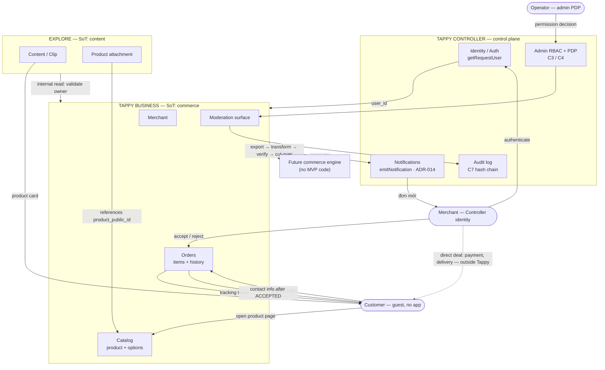
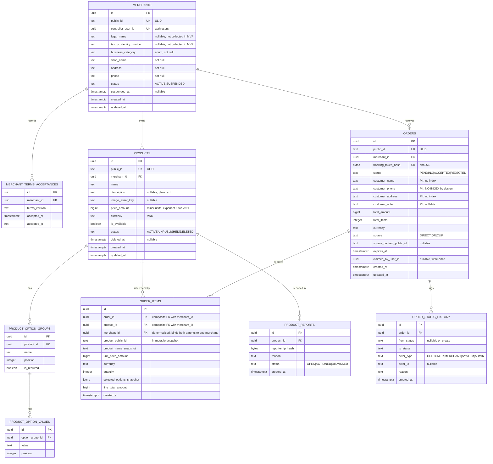
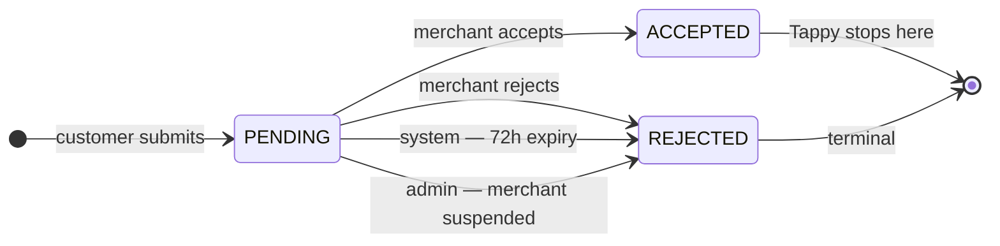
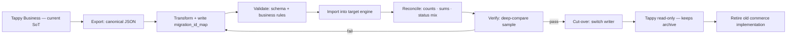

# Tappy Business — Phase 0 Architecture (FROZEN)

> **Status:** Phase 0 complete. Architecture, ERD, state machine, API contract, security
> model, migration strategy and scope are **LOCKED**. No production code written yet.
> **Date:** 2026-09-08 · **Owner:** platform
> **Governing contract:** the approved Tappy Business architecture contract (§1–§49).
> Companion to [`AI_PLATFORM.md`](../architecture/AI_PLATFORM.md) and
> [`BACKEND_OWNERSHIP.md`](../architecture/BACKEND_OWNERSHIP.md).

Tappy Business is a merchant ordering capability: **Merchant → Product → Customer →
Order → Accept/Reject**. Tappy provides infrastructure only — it does not collect or
hold money, ship, deliver, or become the seller. After `ACCEPTED`, merchant and
customer deal directly and Tappy stops tracking the transaction.

---

## 1. Repository inspection (contract §44) — what already exists

**Inspection base:** `origin/main` @ `b85ddd9`, read in the worktree
`.worktrees/tappy-business-p0` (branch `feat/tappy-business-p0`).

> **Correction, recorded rather than hidden.** The first pass of this inspection was run in the
> `feat/consultative-d1-d2-r1-r2-d3` checkout, which is **284 commits behind `origin/main`**.
> Two findings were wrong there and are corrected below (F2, F5); three guard rules that exist
> only on `main` were missed entirely and are now included. Everything in this section has been
> re-verified against `origin/main`.

| Need | Existing component | Verdict |
|---|---|---|
| Identity / authentication | `getRequestUser()` — `src/lib/auth/getRequestUser.ts`; Supabase auth (cookies web, Bearer native) | **REUSE** |
| Admin RBAC + PDP | `src/lib/admin/permissions/{engine,registry,resolver,guards}.ts` — C3/C4 **ACCEPTED · IN PRODUCTION** | **REUSE** (back-office only — see F1) |
| Back-office module registration | `ControllerCore` + `validateManifest` — `src/lib/controller/{core,manifest,types}.ts`. `commerceHub` already defined at `src/lib/controller/registry/adminModules.ts:27` | **REUSE** |
| Merchant notification | `emitNotification()` — `src/lib/notifications/emit.ts` (ADR-014 unified notifications) | **REUSE** |
| Media / assets | `src/lib/media/*` — GCS + WIF, key validation (`key.ts`, `ALLOWED_MEDIA_PREFIXES`), `uploadPolicy.ts`, `uploadRoute.ts`, `servableMedia.ts`; magic-byte checking in `src/lib/security/imageType.ts`; `sharp` already a dependency | **REUSE** |
| QR generation | `src/lib/qr/qrcode.ts` (+ `qr` npm dep) | **REUSE** |
| Rate limiting | `src/lib/security/distributedRateLimit.ts` (Upstash Redis) and `rateLimit.ts` | **REUSE** |
| API error envelope | `src/lib/http/apiError.ts` → `{ error: <machine code>, message: <localized> }` + `serverMessages` catalogue | **REUSE** |
| Service-role DB access | `createAdminClient()` — `src/lib/supabase/admin.ts`, the **only** sanctioned construction point (C9a) | **REUSE** |
| Audit trail | `audit_log` hash chain (C7, deployed) + `src/lib/controller/auditAdapter.ts` | **REUSE** |
| Durable event delivery | C8 Event Bus — `src/lib/controller/outbox.ts`, `supabase/migrations/20260813_c8_event_outbox.sql`, `src/app/api/cron/outbox-drain/` — all **shipped on main** | Available; **not used in MVP** (F2) |
| Testing | `vitest`; `embedded-postgres` for real-PostgreSQL integration tests | **REUSE** |
| Build-time architecture enforcement | `scripts/architecture/check.mjs`, `scripts/architecture/check-sql-grants.mjs` (ADR-019) | **REUSE (mandatory)** |

> `src/lib/governance/dataClassification.ts` does **not** exist on `main` — the Phase 6
> governance layer (ads, contacts, messaging, data classification) lives only on the
> `feat/consultative` branch. There is therefore no classification-registration obligation on
> this base, and no `src/lib/contacts/hash.ts` to reuse or be fenced from.

**There is no existing merchant, catalog or order concept.** `partner_deals`
(`supabase/migrations/20260724_partner_deals.sql`) is admin-curated marketing content: no
owner, no orders, no merchant identity, writes only via service role. It is not a merchant
system and must not be extended into one.

> **Table count, corrected.** An earlier summary in this document said "7 tables". That
> collapsed the two option tables into one line and omitted `business_merchant_terms_acceptances`.
> The ERD in §5 is authoritative and has always shown **nine** physical tables; the P0 migration
> creates nine. Dropping either omitted table would break §8 (terms acceptance) or §12
> (structured options).

### Database and API conventions observed

- `UUID PRIMARY KEY DEFAULT gen_random_uuid()`, `snake_case`, `public` schema.
- RLS **enabled and deny-by-default**; public `SELECT` policies only; all writes via the
  service-role client in API routes.
- Idempotent DDL (`CREATE TABLE IF NOT EXISTS`, `DROP POLICY IF EXISTS`), `touch_updated_at`
  trigger pattern, migrations named `YYYYMMDD_name.sql` (78 present on `main`).
- `supabase-schema.sql` at repo root is a **partial legacy baseline (8 tables)** — the real
  schema is the migration set. Business ships migrations; it does not edit that file.

---

## 2. Findings that constrain the design

### F1 — Merchant authorization is ownership, not admin RBAC · **binding**

The PDP's `Actor` is a back-office operator. Granting an end-user merchant a
`PERMISSIONS.COMMERCE_*` permission would put ordinary users inside the admin permission
model. Merchant scope is therefore **resource ownership**:

```
Controller identity (getRequestUser)
   → merchants.controller_user_id = auth.uid()
   → merchant_id
   → scoped query
```

This is the pattern the product already uses for user-owned rows, not a second RBAC — §4 is
satisfied. The admin PDP is used **only** for the moderation/back-office surface
(suspend merchant, unpublish product, review reports).

**Two mechanisms stand behind `authz.ts`, and neither depends on it being called** (added
after the P0 final review, which found that its use was a convention rather than a
constraint):

1. **The schema.** `business_order_items` carries `merchant_id` and both of its foreign keys
   are composite, so an order item mixing two merchants cannot be written at all. See §5.
2. **The architecture guard.** `no-business-tables-outside-data-layer` fences the nine
   Business table names to `src/lib/business/repositories/`. A query written anywhere else in
   `src/` fails `npm run architecture:check` in CI. The rule mirrors the messenger-table
   fence and is covered by `scripts/architecture/businessDataBoundary.test.ts`.

Every repository function that touches merchant-owned rows takes `MerchantContext` as its
**first argument**, so the scope is visible in the signature rather than buried in the body.
The one exception is `findMerchantByControllerUser`, which *creates* the context and would
otherwise be circular; `resolveMerchantContext` re-checks the row it returns.

Row-level scoping itself is still this module's responsibility — the tables carry no RLS
policies — so its isolation tests remain the proof that the boundary holds.

### F2 — The Explore projection is deferred because it is unnecessary, not because transport is missing · **corrected**

**What the first pass claimed:** that C8 Event Bus was uncommitted work-in-progress with a
missing migration, so Business could not depend on it. **That was measured on the stale
branch and is wrong.** On `origin/main`, C8 is shipped: `src/lib/controller/outbox.ts`, its
test, `src/app/api/cron/outbox-drain/` and `supabase/migrations/20260813_c8_event_outbox.sql`
are all present and committed. `outbox.ts` does note it has no producers or consumers yet —
Business would be the first, which is a reason for care, not for avoidance.

**The decision is unchanged, on its own merit.** The Explore product-card projection (§31) is
**deferred**: the approved Conflict-4 resolution already requires orderability to be read from
Business when the product page loads, so a projection would add a second copy of product data
without removing a single read. §31 remains the governing rule if a projection is ever built,
and C8 is the transport it would use.

Merchant notification calls `emitNotification()` directly (shipped, in production). Routing it
through the outbox would buy durability at the cost of becoming C8's first production consumer
during Business's own first release — a bad time to be someone else's pilot. Revisit after MVP.

### F3 — No encryption capability exists in this codebase · **binding**

MEASURED: no `createCipheriv`, `pgcrypto`, `pgsodium` or `pgp_sym_encrypt` anywhere in
`src/` or `supabase/`. Introducing application-level column encryption would be net-new
security infrastructure, which §44 forbids inventing before verifying alternatives.

**Consequence:**

- Order PII is protected by the controls the repo already relies on: RLS deny-by-default,
  service-role-only writes, **no index on `customer_phone`**, masking at the API boundary,
  and retention deletion (§7 below).
- `tax_or_identity_number` remains a nullable column that is **not collected in MVP**.
  §6.5 already makes it progressive. Activating collection requires introducing an
  encryption capability first — flagged here, deliberately not built.
- `createHmac` (node stdlib) supplies the phone rate-limit key. There is no shared hashing
  helper on `main` to reuse, so Business owns a small local one.

Verified on `origin/main`: the only occurrence of `pgcrypto` anywhere is a comment in
`supabase/migrations/rollback/20260830_push_credential_ownership_rollback.sql`. No encryption
capability exists in this codebase.

### F4 — Identifier convention: UUID PK **and** ULID `public_id`

Repo convention is a `gen_random_uuid()` PK exposed publicly (`partner_deals`). Contract §11
requires an internal PK plus a separate stable `public_id`. Both are honoured: `UUID` PK for
internal joins and FKs, ULID `public_id` for every external reference and as the migration
anchor (§40). The redundancy is accepted and recorded rather than resolved silently.

### F5 — Guard obligations that bind Business · **corrected and expanded**

The first pass listed a data-classification obligation that does not exist on this base, and
missed three Controller rules that `check.mjs` enforces on `main`:

1. **`no-permission-string-literal`** — a permission id must be `PERMISSIONS.<KEY>` from
   `@/lib/admin/permissions/registry`. Matched on argument position *and* on the manifest
   fields `permissions:`, `visibilityPermission:` and `permissionScope:`. **Business must add
   its `COMMERCE_MERCHANTS_*` ids to the registry before writing the manifest** — a raw string
   does not get past CI.
2. **`no-module-imports-module`** — a Controller module may not import a sibling module.
   Business's manifest takes `commerceHub` from the shared registry file, never from
   `commerceDealsModule`.
3. **`no-consumer-app-import-in-controller`** — Controller code may import only from an
   allowlist of Security Core zones. **The Business manifest, living under
   `src/lib/controller/`, may not import `@/lib/business/`.** It must be self-contained, in the
   shape `moderationModule.ts` already demonstrates: types, `PERMISSIONS`, and a hub descriptor.
4. **`check-sql-grants.mjs`** (ADR-019) applies to every new migration: on Supabase
   `REVOKE ... FROM PUBLIC` does **not** close a function; explicit grants are required.
5. Service-role clients come from `createAdminClient()` only (`no-adhoc-service-role-client`).

---

## 3. Boundary map (contract §45)

```
EXISTING SYSTEM
  Controller: identity · admin RBAC/PDP · audit · module registry (commerceHub)
  Platform:   notifications · media/GCS · QR · Upstash rate limit · apiError · vitest
        ↓
TAPPY BUSINESS BOUNDARY
  Owns: merchant commerce profile · product · product options · order ·
        order item · order status history · product report
  Does not own: identity · auth · RBAC · events · notifications infra ·
        analytics · content/clips · product attachment
        ↓
NEW COMPONENTS REQUIRED                       ↓ EXISTING COMPONENTS REUSED
  src/lib/business/**  (domain module)          getRequestUser
  src/lib/business/repositories/ (data layer)   createAdminClient
  9 tables + one migration                      admin PDP (moderation surface only)
  /api/business/*, /api/public/business/*       emitNotification
  /business UI (merchant surface)               media pipeline + imageType + sharp
  admin manifest tappy.hub.commerce.business    qrcode.ts
  COMMERCE_MERCHANTS_* permission entries       distributedRateLimit (Upstash)
  business-local HMAC phone-hash helper         apiError + serverMessages
                                                createAdminClient
                                                audit_log / auditAdapter
                                                embedded-postgres integration harness
```

**Justification for each new component** (§45 requires this):

| New component | Why existing infrastructure cannot be reused | Ownership | Complexity | Migration impact | Test impact |
|---|---|---|---|---|---|
| `src/lib/business/` | No merchant/catalog/order domain exists; `partner_deals` is unowned admin content | Business | Low — pure domain + repository | 9 tables | New suites (§9) |
| Business tables | Nothing to extend without giving `partner_deals` an owner it was not designed to have | Business | Low | 1 migration | Grant + classification tests |
| `/api/business/*` routes | New surface; reuses `apiError`, `getRequestUser`, `createAdminClient` | Business | Low | none | Route + IDOR tests |
| `/business` UI | New merchant surface; admin UI is operator-facing | Business | Medium | none | Component tests |
| Admin manifest + permissions | Registry exists; this adds **entries**, not a registry | Controller registry | Trivial | none | Manifest validation |
| HMAC phone-hash helper | No shared hashing helper exists on `main` | Business | Trivial | none | Unit test |

**Deliberately NOT built:** identity, authentication, RBAC, event bus, analytics,
notification transport, media pipeline, QR generator, rate limiter, encryption layer,
or any dependency on C8.

---

## 4. Architecture (deliverable B)



Ownership boundaries:

| Entity | Sole writer | Read by | Constraint |
|---|---|---|---|
| User, session, admin role | Controller | Business (via token) | Business has no user table; stores `controller_user_id` only |
| Merchant profile | Business | Explore (public fields), admin | No Controller profile fields duplicated here |
| Product, options | Business | Public, Explore (validation) | Explore never writes |
| Order, items, history | Business | Merchant (own), customer (masked) | No other writer |
| Content / Clip | Explore | — | Business never reads; does not know `content_id` |
| Product attachment | Explore | — | References `product_public_id`; no cross-schema FK |
| Notifications, audit, events | Controller | — | Business emits, never stores |

---

## 5. ERD (deliverable C)



### Constraints, indexes, ownership

| Table | Unique | Indexes | Rules |
|---|---|---|---|
| `merchants` | `public_id`, `controller_user_id` | `(status)` | One user = one merchant in MVP. RLS: owner reads own row; public reads a narrow view. |
| `merchant_terms_acceptances` | `(merchant_id, terms_version)` | `(merchant_id)` | Append-only. No UPDATE/DELETE. |
| `products` | `public_id` | `(merchant_id, status, created_at DESC)` | `price_amount >= 0`. No hard delete — `status='DELETED'` + `deleted_at`. |
| `product_option_groups` | `(product_id, name)` | `(product_id, position)` | No `price_delta`, no stock column — deliberate (§12, §13). |
| `product_option_values` | `(option_group_id, value)` | `(option_group_id, position)` | Predefined values only. |
| `orders` | `public_id`, `tracking_token_hash` | `(merchant_id, status, created_at DESC)`; partial `(expires_at) WHERE status='PENDING'` | **No index on `customer_phone`** — defence in depth against §16 enumeration. `total_amount = Σ line_total_amount`. |
| `order_items` | — | `(order_id)`, `(product_public_id)` | `quantity > 0`; `line_total = unit_price × quantity`. **Cross-merchant items are unrepresentable**: `merchant_id` is carried on the row and both FKs are composite — `(order_id, merchant_id) → orders(id, merchant_id)` and `(product_id, merchant_id) → products(id, merchant_id)` — each backed by a `UNIQUE (id, merchant_id)` on the parent. Enforced by the schema, not by `authz.ts`. |
| `order_status_history` | — | `(order_id, created_at)` | Append-only; the application DB role holds no UPDATE/DELETE on this table. |
| `product_reports` | — | `(product_id)`, `(status)` | Public insert, rate-limited; admin reads. |

Explore-owned, listed for completeness only:

```
explore.content_product_attachments
  content_id           FK → contents
  product_public_id    text     -- reference, not a cross-schema FK
  merchant_public_id   text
  UNIQUE (content_id)           -- §29: one clip, at most one product
```

---

## 6. Order state machine (deliverable D)



| From → To | Actor | Guard | Reason | Customer sees |
|---|---|---|---|---|
| ∅ → `PENDING` | CUSTOMER | product ACTIVE + available; merchant ACTIVE; rate limit + Turnstile pass | `CREATED` | Đã đặt hàng |
| `PENDING` → `ACCEPTED` | MERCHANT | owns order; merchant ACTIVE; row still `PENDING` at UPDATE time | `MERCHANT_ACCEPTED` | Đã chấp nhận + shop contact |
| `PENDING` → `REJECTED` | MERCHANT | owns order | `MERCHANT_REJECTED` / `SPAM` | Không nhận được đơn |
| `PENDING` → `REJECTED` | SYSTEM | `now() >= expires_at` | `EXPIRED` | Không nhận được đơn |
| `PENDING` → `REJECTED` | ADMIN | merchant moved to SUSPENDED | `MERCHANT_SUSPENDED` | Không nhận được đơn |

**Forbidden:** `ACCEPTED → *`, `REJECTED → *`, `* → PENDING`, `ACCEPTED → REJECTED`.
Enforced at three layers: domain guard, `WHERE status='PENDING'` in SQL, and a CHECK
constraint rejecting a terminal `from_status` in history.

Every transition is a conditional update — never SELECT-then-UPDATE:

```sql
UPDATE orders SET status = 'ACCEPTED', updated_at = now()
 WHERE id = $1 AND status = 'PENDING';
-- rowcount 0 → 409 order_not_pending ; rowcount 1 → insert history, notify
```

The expiry job uses the same shape plus `AND expires_at <= now()`, making it idempotent and
race-safe against a merchant accepting at the 72-hour boundary.

---

## 7. API contract (deliverable E)

Envelope is the repo standard: `{ error: <machine code>, message: <localized> }` from
`apiError()`. `404` is returned for both "does not exist" and "not yours" so the API never
confirms existence to a non-owner.

### Public — unauthenticated, treated as hostile

| Endpoint | Auth | Request | Response | Controls | PII exposed |
|---|---|---|---|---|---|
| `GET /api/public/business/products/{public_id}` | none | — | product + `{shop_name, business_category}` | IP rate limit | none |
| `POST /api/public/business/orders` | Turnstile | product, quantity, options, customer, source | `{status, tracking_url, total_amount, currency, notice}` | IP + product + `HMAC(phone)` rate limits; `Idempotency-Key` required | writes PII, returns none |
| `GET /api/public/business/orders/by-hash` | token hash header | — | status, items, **masked** customer, merchant contact **only when ACCEPTED** | strict rate limit; `noindex`/`no-referrer` on the page | masked only |
| `POST /api/public/business/products/{public_id}/report` | Turnstile | reason | `{ok:true}` | IP-hash rate limit | none |

### Merchant — Controller identity; `merchant_id` from context only (F1)

`POST /api/business/onboarding` · `GET|PATCH /api/business/me` ·
`POST|GET /api/business/products` · `GET|PATCH|DELETE /api/business/products/{public_id}` ·
`POST /api/business/media/upload-intent` · `GET /api/business/orders` ·
`GET /api/business/orders/{public_id}` ·
`POST /api/business/orders/{public_id}/accept` · `.../reject` ·
`POST /api/business/orders/bulk-reject`

All merchant endpoints: full PII visible to the owning merchant; cursor pagination;
`merchant_id` never read from body, query or path.

### Internal — service token

`GET /internal/business/products/{public_id}` — lets Explore validate that a product exists
and belongs to the acting merchant before creating an attachment. Business exposes **no**
attachment mutation endpoint (§6.1).

### Admin — admin PDP (`COMMERCE_MERCHANTS_*`)

`POST /api/admin/business/merchants/{public_id}/suspend` (auto-rejects that merchant's
PENDING orders) · `POST /api/admin/business/products/{public_id}/unpublish` ·
`GET /api/admin/business/reports`

### Example

```jsonc
// POST /api/public/business/orders
// Idempotency-Key: 01J8ZQ4K7N3M2P9V   X-Turnstile-Token: 0.abc...
{
  "product_public_id": "01J8Z9Q3M4K5N6P7R8S9T0V1W2",
  "quantity": 2,
  "selected_options": [{ "group": "Màu", "value": "Đỏ" }, { "group": "Size", "value": "M" }],
  "customer": { "name": "Nguyễn Thị Lan", "phone": "0901234567",
                "address": "128 Nguyễn Văn Cừ, Q5, TP.HCM", "note": "Giao sau 18h" },
  "source": "CLIP", "source_content_public_id": "01J8ZA..."
}
// No price field anywhere. The server recomputes every amount from the database.

// 201
{ "status": "PENDING", "tracking_url": "https://tappyai.com/order/9f3Kx2...",
  "total_amount": 90000, "currency": "VND", "total_items": 2,
  "notice": "Tạm tính — chưa gồm phí vận chuyển. Shop sẽ xác nhận tổng tiền cuối cùng." }
```

Retrying with the same `Idempotency-Key` inside 24h replays this response verbatim —
same `tracking_url`, no second order. Same key with a different body → `422`.

---

## 8. Security model (deliverable F)

The attack surface is small but lopsided: **one unauthenticated write endpoint that stores
PII**, and **one bearer credential in a URL that users are encouraged to share**.

| # | Threat | Control |
|---|---|---|
| T01 | Fake-order flood against a shop | IP + product + `HMAC(secret, phone_e164)` limits in Upstash; Turnstile; merchant bulk-reject |
| T02 | IDOR across merchants | `merchant_id` from session only (F1); RLS owner policies; automated two-account test over every merchant route |
| T03 | Tracking-token brute force | ≥128-bit random; only `SHA-256` stored; lookup by hash; rate limit + miss-rate alert |
| T04 | Tracking URL leaked by sharing / preview bots | Masked PII only; `X-Robots-Tag: noindex, nofollow`; `Referrer-Policy: no-referrer` |
| T05 | Raw token reaching logs | Web layer hashes before calling the API; token never enters the API tier; edge scrub on `/order/*` |
| T06 | Database read exposing customer PII | RLS deny-by-default; service-role-only writes; **no phone index**; API masking; retention deletion (F3 — no encryption layer invented) |
| T07 | Catalogue enumeration | No public product-list endpoint; ULID-only access; shared 404 |
| T08 | Illegal or fraudulent listings | Public report; suspend merchant; unpublish product; suspend auto-rejects PENDING orders |
| T09 | GPS EXIF in product images leaking merchant home address | Strip EXIF on ingest via the existing `sharp` pipeline; magic-byte validation (`imageType.ts`); size cap |
| T10 | Stored XSS via product name/description | Plain text only in MVP — no HTML, no markdown; escaped at render; existing CSP |
| T11 | Client-side price manipulation | No price field accepted; server recomputes totals from the database |
| T12 | Duplicate order from a retried request | `Idempotency-Key` + unique `(scope, key)` in Redis, 24h TTL |
| T13 | Accept racing the expiry job | Conditional UPDATE with rowcount check |
| T14 | Turnstile token replay | Server-side siteverify, single use, bound to IP + action |
| T15 | Wrong-person order claim (future) | Phase 1.5: token possession **and** last-4 of phone **and** write-once `claimed_by_user_id`. Never phone alone. |

### PII retention policy (contract §7.3 / §37)

| Field | Class | Retention | After expiry | Exception |
|---|---|---|---|---|
| `customer_name`, `customer_phone`, `customer_address`, `customer_note` | PRIVATE | **SUPERSEDED — see [P5](P5_DATA_RETENTION.md).** The 90-day figure below had no legal basis and pointed the wrong way: Luật TMĐT 122/2025/QH15 Art. 17(2)(i) requires contract data to be kept ≥3 years (≥1 for SMEs). Retention floor now runs from the **contract date**, not the terminal state. | No anonymisation job exists or may be enabled | Awaiting Vietnamese counsel on platform classification and PII scope |
| `merchant.legal_name`, `tax_or_identity_number` | SENSITIVE | Lifetime of the merchant relationship | Not collected in MVP (F3) | — |
| `product_reports.reporter_ip_hash` | PRIVATE | 180 days | Deleted | — |
| `order_status_history` | PUBLIC (non-PII) | Indefinite | — | Audit and migration integrity depend on it |

Deletion nulls PII columns; it never deletes order rows, because §37 forbids losing data
needed for audit or migration.

### Invariants that must be automated tests, not review

1. Merchant A cannot reach merchant B's products or orders (driven off the route table).
2. `ACCEPTED` cannot become `REJECTED`, and vice versa — fuzz every transition pair.
3. `PENDING` expires correctly and the job is idempotent.
4. A duplicate `Idempotency-Key` never creates a second order.
5. The tracking response never contains unmasked PII (allow-list snapshot test).
6. No endpoint accepts a phone number as an order lookup key.
7. A historical order snapshot does not change when the product changes.

---

## 9. Migration strategy (deliverable G) — target-independent



Rollback before cut-over is a no-op, because Tappy remains authoritative until that step.
The rollback window closes when Retire begins.

```
migration_id_map
  entity_type      MERCHANT | PRODUCT | OPTION_GROUP | ORDER | ORDER_ITEM | ASSET
  tappy_public_id  text
  target_id        text
  content_checksum bytea
  migrated_at      timestamptz
  UNIQUE (entity_type, tappy_public_id)
  UNIQUE (entity_type, target_id)   -- two sources may never map to one target
```

| Landmine | Risk | Handling |
|---|---|---|
| **VND exponent** | VND exponent is **0**. A target defaulting to 2 inflates every historical price 100× silently | Exponent recorded in the export contract; reconciliation compares **monetary totals**, not only row counts (§41) |
| Status mapping | `ACCEPTED`/`REJECTED` exist in no engine's default status set | Mapping table agreed now and shipped with the export contract |
| Options | Structured attributes do not map 1-1 onto a variant matrix | Why §12 forbids free text. If the target lacks an equivalent, `selected_options_snapshot` remains the historical truth |
| Media | Assets are files, not rows | `ASSET` is an entity type in the map; transfer → rewrite key → per-file checksum |
| `order_status_history` | Target engines rarely have an equivalent | Stays in Tappy as an **immutable archive**: append-only, never written after cut-over, serving no live commerce flow — an archive, not a second authoritative copy |
| Merchant identity | Both sides writing the profile violates §5 on day one | Controller keeps identity; target keeps the vendor commerce record; 1-1 via `merchant_public_id`; one writer per field |

Cut-over requires **all** of: entity counts equal; monetary totals equal per month; status
distribution equal; zero orphan items or orders; 1% random deep-compare plus 100% of recent
`ACCEPTED` orders; every asset checksum matching. There is no "99% pass".

---

## 10. Scope review (deliverable H)

| Item | Class | Rationale |
|---|---|---|
| `orders.source` + `source_content_public_id` | **MVP** | Approved §7.1/§35. Two columns; no dashboard, no counters |
| Device-local tracking recovery | **MVP** | Approved §7.2/§36. Convenience only; never authorization |
| PII retention policy + job | **MVP** | Approved §7.3/§37; policy defined in §8 above |
| Explore product-card projection | **LATER** | F2 — not needed; orderability is read from Business at page load |
| Claim order after install | **LATER** | Hardest authorization problem, least MVP value; schema ready (`claimed_by_user_id`) |
| Phone OTP | **LATER** | Only if real abuse proves the need (§23) |
| Per-variant pricing / stock | **LATER** | §12 |
| Multiple products per clip | **LATER** | Drop `UNIQUE(content_id)` when needed |
| Staff accounts under one merchant | **LATER** | Restaurants will want it; a deliberate migration, not an incident |
| Customer cancel | **REJECT** | §18 |
| `DELIVERED` / `COMPLETED` | **REJECT** | Pulls Tappy into fulfilment; breaks §1 and §28 |
| Stock decrement / reservation | **REJECT** | §13 — a second state machine beside the order |
| Shipping fee / distance | **REJECT** | §17 |
| Merchant analytics dashboard | **REJECT** | §32 |
| Cross-merchant search or cart | **REJECT** | Marketplace; §29 |
| Adopting Medusa / Saleor / Vendure / Bagisto | **REJECT** | §11 below |

---

## 11. OSS evaluation (deliverable §46)

Run after the architecture and repository inspection, as required.

| Candidate | License | Verdict | Reasoning |
|---|---|---|---|
| **Medusa / Saleor / Vendure / Bagisto** | MIT / BSD-3 / MIT / MIT | **REJECT** | Each carries its own merchant, product, order and customer model. Adopting one creates a second commerce system to migrate *from* — inserting an extra layer into §39's chain — for perhaps a few weeks of saved work on 9 tables and ~20 endpoints. Directly violates §5 and §49. |
| **`ulid` (npm)** | MIT | **PARTIAL REUSE** | ~1 kB, no transitive deps, stable. Satisfies §11 without a Postgres extension. Alternative is ~40 lines in-house; the library is the smaller liability. |
| **QR libraries** | — | **REJECT (already solved)** | `src/lib/qr/qrcode.ts` and the `qr` dependency exist. Adding another is duplicate infrastructure. |
| **Cloudflare Turnstile SDK** | — | **REJECT (not needed)** | Verification is one `fetch` to `siteverify`. A dependency for one HTTP call is not worth the supply-chain surface. |
| **`zod`** | MIT | **REUSE (present)** | Already the repo's validation library. |
| **`sharp`** | Apache-2.0 | **REUSE (present)** | Already a dependency and already in the media path — covers EXIF stripping and re-encode. |
| **State-machine libraries (XState etc.)** | MIT | **REJECT** | Three states and four transitions. A conditional UPDATE plus a guard function is smaller and is where the correctness actually lives. |

Net new dependencies: **one** (`ulid`), and only if the in-house alternative is rejected at
implementation time.

---

## 12. Phase plan (deliverable I)

| Phase | Objective | Modules / migration / API / UI | Tests | Acceptance | Depends on | Rollback |
|---|---|---|---|---|---|---|
| **P0** Foundations | Primitives only, no business behaviour | `src/lib/business/{ids,money,errors}`; one migration with all 9 tables + RLS + grants; `COMMERCE_MERCHANTS_*` ids added to the permission registry; ownership middleware | Money exponent; ULID; grant guard; permission-literal guard | `npm run architecture:check` and `check:sql-grants` pass; middleware rejects any handler reading `merchant_id` from a request | — | Drop migration; no user-visible surface |
| **P1** Merchant + Catalog | Merchant onboards and lists products | Onboarding + terms in one transaction; product CRUD + options; media upload intent reusing the GCS pipeline; soft delete; `/business` UI | IDOR suite over every route; soft-delete resolves to "ngừng bán"; EXIF stripped (fixture with GPS) | Merchant A gets 404 on every one of B's resources | P0 | Feature-flag the `/business` surface off |
| **P2** Public order | Guest can order and track | Public product page; `POST orders` + Turnstile + rate limits + idempotency; tracking token + masked page; `noindex`/`no-referrer`; localStorage recovery | 100 concurrent same-key requests → exactly 1 order, identical `tracking_url`; allow-list snapshot on public responses; log grep finds no raw token | All of the above green | P1 | Disable public route; merchant data untouched |
| **P3** Order management | Lifecycle closes | List/detail with full PII; accept/reject conditional update; bulk reject; status history; 72h expiry job; `emitNotification` on new order | Transition fuzz — only 4 pairs pass; accept vs expiry race; expiry job idempotent | No order leaves a terminal state under any input | P2 | Expiry job disabled independently |
| **P4** Moderation | Operable without database edits | Suspend merchant (+ auto-reject PENDING); unpublish product; report product; admin module manifest under `commerceHub` + `COMMERCE_MERCHANTS_*` permissions | Manifest validation; permission-gated route tests; suspend cascade | Suspend stops new orders immediately at the product page | P3 | Permissions revocable; manifest `status: 'disabled'` |
| **P5** Explore attachment | Discovery channel works | Attachment API owned by Explore; internal validation endpoint in Business; product card; deep link; `orders.source` populated | Attachment rejects a product the caller does not own; unpublish removes the card | Clip → product → order records `source='CLIP'` | P4 | Attachment endpoint removable; no Business data affected |
| **P6** Export tooling | The only insurance §39–§41 actually buys | Canonical export; `migration_id_map`; reconciliation queries. **No import, no target engine** | Export → import into an empty database → reconcile 100% | Runs weekly in CI so the export contract cannot rot | P3 | Read-only; nothing to roll back |

---

## 13. Phase 0 acceptance (contract §43)

| Criterion | State |
|---|---|
| No unresolved architectural conflict | ✅ five prior conflicts resolved and locked; no new conflict found |
| Ownership unambiguous | ✅ §4 table |
| ERD internally consistent | ✅ §5 |
| Every Order / Product field has an owner | ✅ §4 + §5 |
| Public IDs defined | ✅ F4, §5 |
| Tracking token design defined | ✅ §7, §8 |
| PII exposure defined | ✅ §7 (masking) + §8 (retention) |
| Order transitions formally defined | ✅ §6 |
| Expiration behaviour defined | ✅ §6 |
| Idempotency defined | ✅ §7, T12 |
| Merchant isolation testable | ✅ §8 invariant 1 |
| Moderation path defined | ✅ §7 admin, P4 |
| Notification dependency defined | ✅ `emitNotification`, F2 |
| Migration invariants documented | ✅ §9 |
| VND exponent documented | ✅ §9, P0 test |
| PII retention documented | ✅ §8 |
| No CS-Cart-specific code | ✅ none exists |
| No production code written | ✅ none written |
